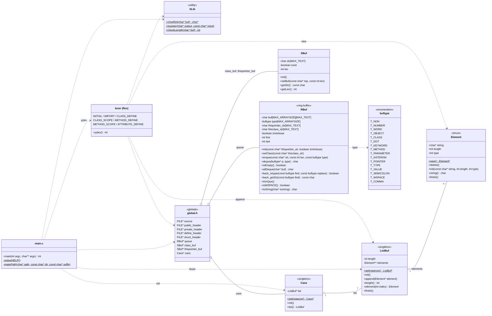

# Class diagram

Classes of caos. `Caos`, `ListBuf`, `Element`, `SBuf`, `RBuf` and `SLib` are written in `src/*.caos` and generated by caos itself (see "Self-hosting" in the [README](../README.md)). `main.c` and the lexer are written in C / flex.

